# IRON DAWN（钢铁黎明）· 红警风格 3D RTS DEMO

一个可直接在浏览器里游玩的、以《红色警戒》手感为灵感的原创单机即时战略 DEMO。没有战役，只有一张遭遇战地图、两名可选阵营和一个会真正发展经济、建造基地、成波进攻并使用超级武器的 AI。界面已完整中文化（品牌标题为「贱客战争」，快捷键保留字母）。

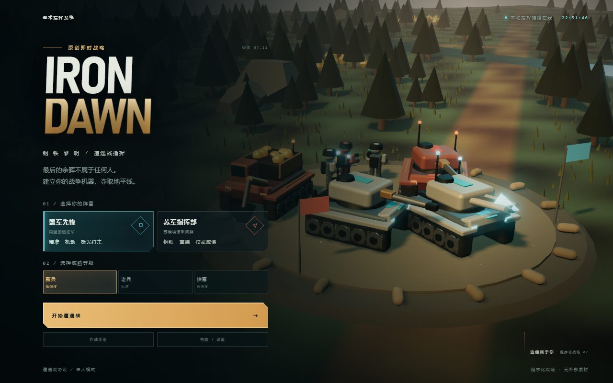
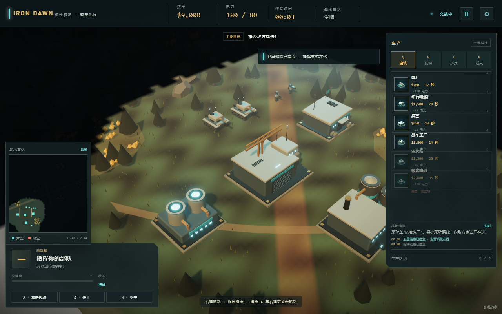

## 立即开始

### Windows 一键启动（推荐）

双击游戏目录中的 **`启动游戏.cmd`**。

它会自动：
1. 检查本地游戏服务是否已经在运行；
2. 如果未运行，则打开一个 Node 服务器窗口并启动 `server.mjs`；
3. 等待服务就绪后，用默认浏览器打开游戏。

关闭新打开的 Node 服务器窗口即可停止服务。当前环境若已使用其他方式启动了服务，脚本会直接复用并只在浏览器中打开游戏。

命令行方式：

```powershell
cd "D:\DeepSeek Harness WorkSpace\红色警戒"
node server.mjs
```

打开 **http://127.0.0.1:4173/**。

- 已验证的浏览器：Chromium / Edge（桌面端）。
- 不需要构建、不需要联网、不需要安装额外运行时依赖。Three.js 已经位于 `node_modules/three`。
- 如果没有安装 Node.js，请先安装 Node.js 20+；如果 `node_modules` 丢失，可在项目目录执行：`npm install --ignore-scripts`。
- 静默检查脚本（不打开浏览器）：`powershell -NoProfile -ExecutionPolicy Bypass -File .\start-game.ps1 -NoBrowser`

## 这局游戏有什么

- **双阵营**：盟军 / 苏军。模型、配色、单位和超级武器都有明显区别。
- **完整经济循环**：矿车自动采矿 → 精炼厂卸矿 → 资金；电力盈余影响生产与防御；矿车可被截杀。
- **生产与建造**：三个独立生产队列；前置科技、电力要求、建造范围、放置预览、出售退款、维修、集结点。
- **真实 AI 对手**：独立基地、电厂/精炼厂/兵营/战车工厂/雷达/防御/超级武器，按难度扩张并成波进攻，会防守和重建 MCV。
- **RTS 操作**：框选、Shift 增减、双击选同类、右键移动/攻击、攻击移动、停止/守卫、编队、拖动/边缘/键盘镜头、中心跟随、小地图导航。
- **战争迷雾**：未探索黑幕、已探索阴影、敌人在视野外隐藏；小地图同步；雷达在线后改为 ONLINE。
- **战斗**：自动索敌、独立炮塔、子弹/穿甲/火箭/光棱/磁暴弹道、护甲倍率、溅射、碾压、老兵等级、残骸与坍塌。
- **超级武器**：光棱轨道打击 / 核弹发射井，120 秒装填；全屏闪白、镜头震动、蘑菇云、单位与建筑伤害。
- **视觉**：程序化 3D 工业模型，其中战车工厂和先锋主战坦克已替换为 Blender 精细建模 GLB；3D 生成的建造图标、黄昏天空、长阴影、雾、水面、草丛/树木/矿晶、Bloom + FXAA、动态分辨率保护。
- **声音**：原创动态背景音乐（待机 / 生产 / 战斗 / 收束四段，自动交叉淡化）+ WebAudio 程序化音效；可选中文无线电语音；首次交互后启动。
- **完整闭环**：主菜单 → 选阵营/难度 → 遭遇战 → 暂停/设置 → 胜利/失败 → 重开/返回主菜单。

## 默认操作

| 操作 | 键位 |
| --- | --- |
| 选择 / 框选 / Shift 追加 | 鼠标左键 |
| 移动 / 攻击 / 设集结点 | 鼠标右键 |
| 攻击移动 | 轻按 `A`，再右键目的地（长按 A 是镜头平移） |
| 停止 / 守卫 | `S` / `H` |
| 建造标签页 | 短按 `Q / W / E / R` |
| 建造蓝图快捷键 | `1–9` |
| 编队 / 设置编队 | `1–9` / `Ctrl+1–9` |
| 镜头平移 | 长按 `A/D/W/S`、方向键、中键拖动、屏幕边缘 |
| 镜头缩放 / 旋转 | 滚轮 / `Alt`+中键拖动，或长按 `Q/E` |
| 暂停 | `Esc` 或右上角暂停按钮 |
| 出售选中建筑 | `Delete` 或建筑面板的 SELL |

> 首次启动有前线简报。主菜单的 **作战手册** 可查看完整操作手册；HUD 右上角齿轮打开暂停设置，可以关闭边缘滚动与调节音量。

## 目录结构

```text
启动游戏.cmd          Windows 双击一键启动
start-game.ps1        启动、健康检查与浏览器打开逻辑
index.html            入口与 import map
base.css              基础主题、主菜单、弹窗、战场标签
styles.css            AI 生成的工业 HUD 基础样式
hud-extra.css         PM/QA 整合后的 HUD 布局与补充
server.mjs            零依赖静态服务器
src/main.js           场景/输入/主循环/UI 集成（最终整合）
src/core/             游戏仿真：Game, Economy, Combat, AI, Pathfinding, Map
src/data/             阵营、单位、建筑、武器、科技树数据
src/render/           Three.js 场景、地形、模型、效果、后处理
src/ui/               输入、HUD、菜单
src/audio/            外部动态配乐播放与程序化音效
assets/audio/music/   源自 2.5D 项目的四段原创动态配乐
assets/models/        Blender 英雄资产（战车工厂 + 先锋坦克）
docs/HERO_ASSET_WAR_FACTORY.md  战车工厂资产规格与接入记录
docs/HERO_ASSET_VANGUARD_TANK.md  先锋坦克资产规格与接入记录
docs/RADAR_STATION.md  雷达站重做与旋转修复记录
docs/HQ_COMMAND_CENTER.md  主基地重设计与验收记录
.qa/core-test.mjs     无头核心回归测试（8 项）
docs/QA_REPORT.md     PM/QA 记录
```

## 英雄资产：战车工厂

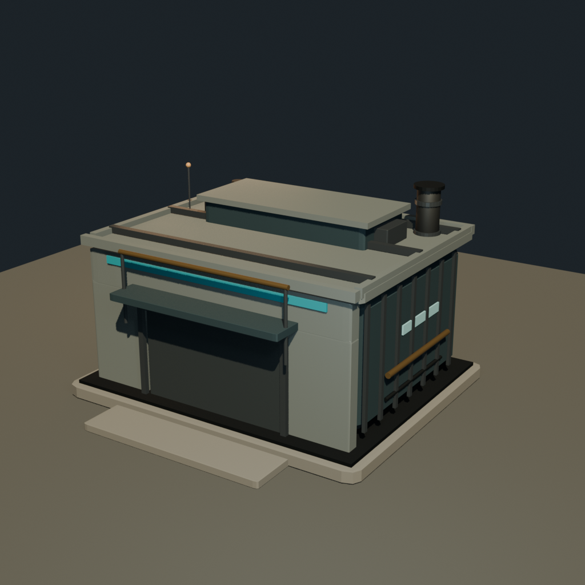
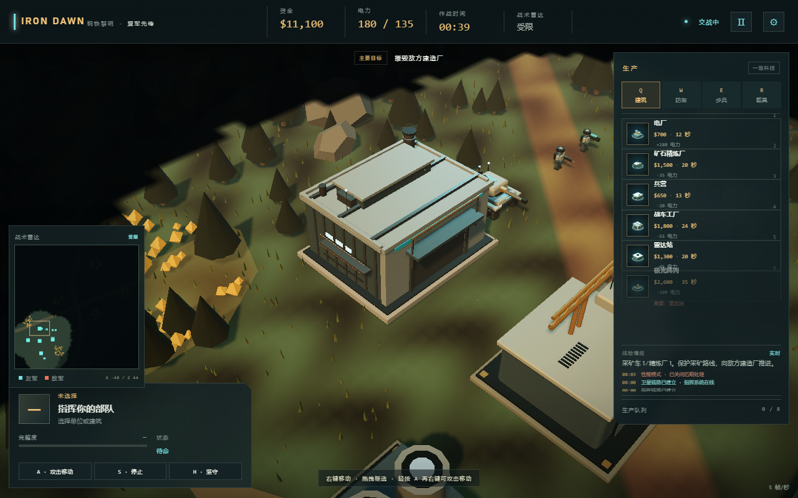

目前第一座由 Blender 精细建模并接入游戏的建筑是**战车工厂**：

- 源文件：[war_factory.blend](assets/models/war_factory.blend)
- 运行时资产：[war_factory.glb](assets/models/war_factory.glb)
- 接入说明：[HERO_ASSET_WAR_FACTORY.md](docs/HERO_ASSET_WAR_FACTORY.md)
- 保留程序化工厂作为 GLB 加载失败或尚未加载时的回退方案
- 模型加载后按材质合批，保留门体枢轴、阵营灯带和发光部件
- 门体动画、烟囱烟雾锚点、建筑升起和阵营配色均已接入

> 这是第一版英雄资产，材质仍是基础 PBR 纯色，下一轮会继续补贴图、背面细节、LOD 和图标更新。

## 英雄资产：先锋主战坦克

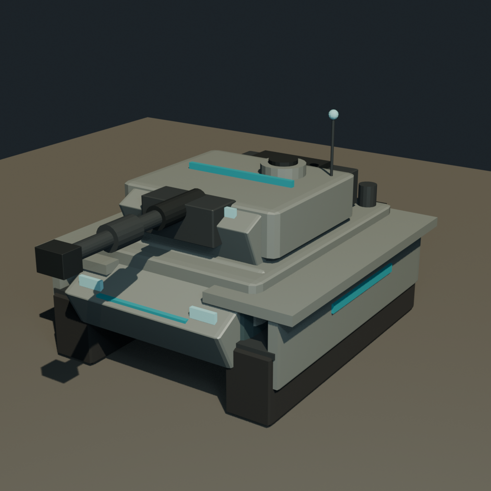
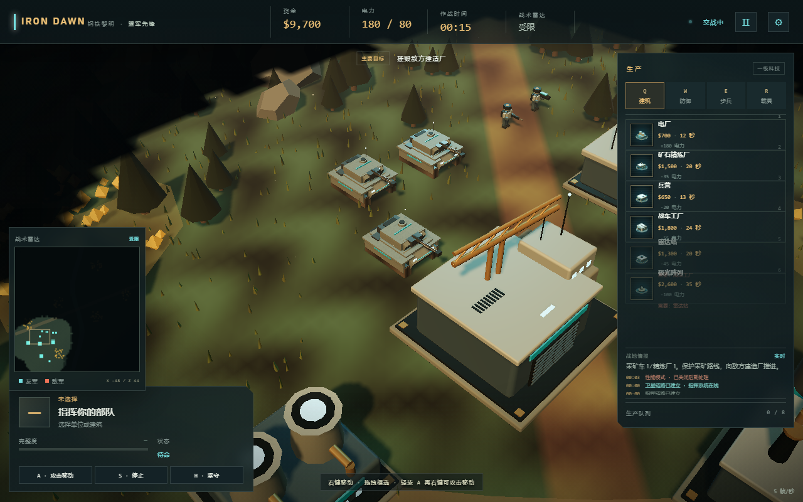
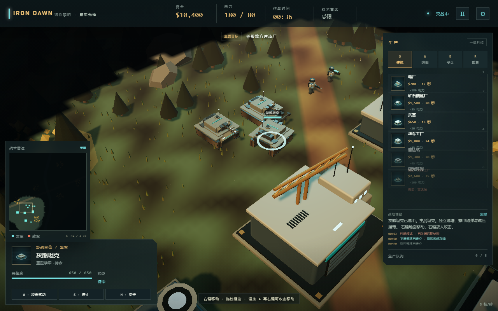
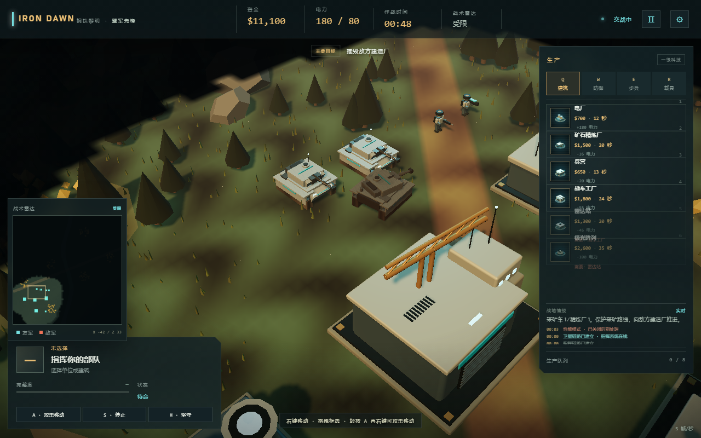

第一辆由 Blender 精细建模并接入游戏的坦克：

- 源文件：[vanguard_tank.blend](assets/models/vanguard_tank.blend)
- 运行时资产：[vanguard_tank.glb](assets/models/vanguard_tank.glb)
- 接入说明：[HERO_ASSET_VANGUARD_TANK.md](docs/HERO_ASSET_VANGUARD_TANK.md)
- 运行时重建 `body → turret → barrel` 层级，保留车体起伏、炮塔旋转和炮管后坐
- 车体、炮塔、炮管分别按材质合批；阵营条和发光件保持独立
- 履带使用逐节 InstancedMesh 链（每侧 18 节）并叠加纹理滚动；左右各 5 组负重轮旋转
- 车体/炮塔增加程序化划痕纹理
- 重载车辆被击毁后会留下冒烟残骸，45 秒后清理
- 远距离自动切换到约 172 顶点的低面数代理，近距离恢复完整层级和动画
- 苏军额外挂载 Blender 制作的 ERA 装甲、炮塔侧颊、尾舱和外挂油箱
- 盟军使用蓝灰/灰绿配色，苏军运行时切换为红褐/棕红配色
- 保留程序化坦克作为 GLB 加载失败时的回退方案

> 第一版坦克没有真实悬挂、完整手工 PBR 贴图、自动减面 LOD 和残骸碰撞；履带链使用简化矩形路径；苏军套件不进入远距离代理；`advanced` 光棱坦克/天启坦克仍使用程序化模型。

## 雷达站重做

原雷达站因为 `getObjectByName('radar')` 命中了同名根节点，导致整栋建筑旋转。已改为独立的 `radar_head` 旋转组，并把主体重做成八角塔楼：

- 八角形塔身、外扩扶壁、前置控制室和观察窗
- 偏置圆形设备舱、管线、电缆和侧置天线
- 盟军：倾斜抛物面雷达碟
- 苏军：大型平板缝隙阵列
- 房体保持静止，仅顶部雷达组旋转

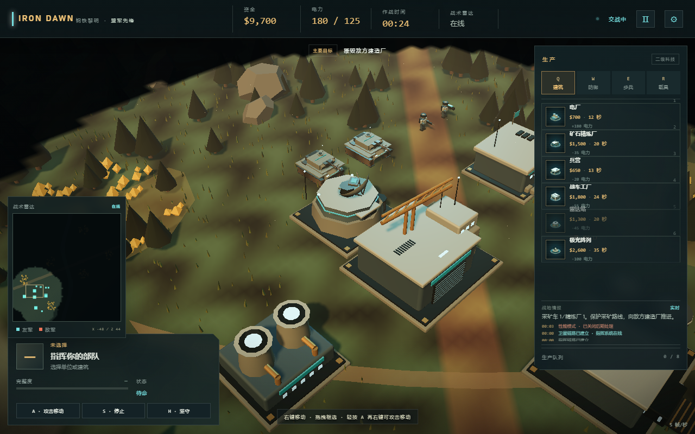

## 主基地升级

主基地已重做为具有明确天际线的指挥中枢，不再是方盒厂房：

- 八角形高层指挥塔和环形观测窗
- 开放式建造庭院、三段入口坡道、悬挑式建造龙门
- 双侧承重翼、后置散热器、通讯桅杆和实体阵营徽记
- 盟军采用流线拱架与通讯冠；苏军采用阶梯重甲与红色装甲鳍片
- 主体固定；吊装滑车沿横梁移动，吊钩独立升降
- 保持现有 10×9 建造占地、建造升起、维修/坍塌和胜负逻辑

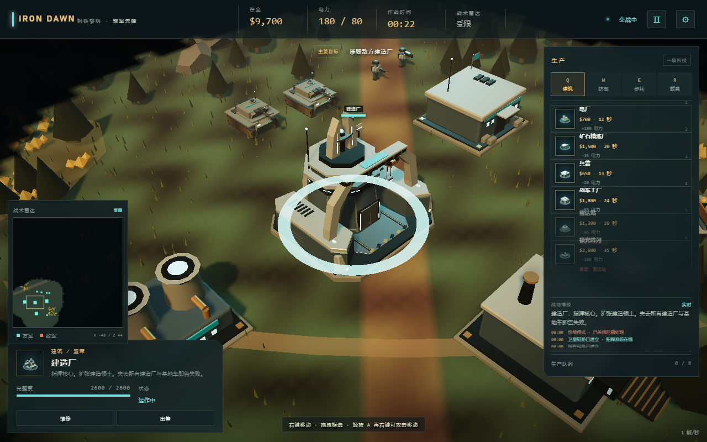
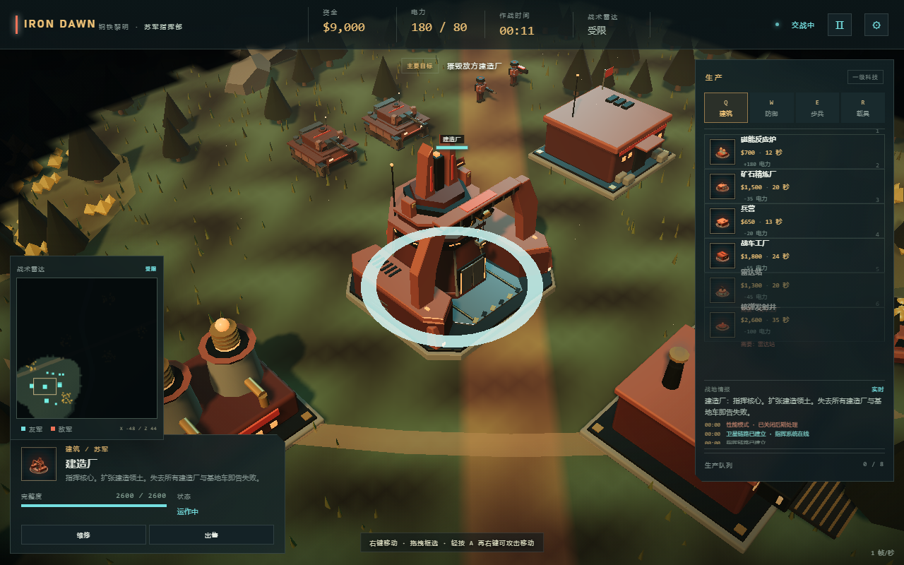

细节见 [主基地设计与验收记录](docs/HQ_COMMAND_CENTER.md)。

详细记录：[RADAR_STATION.md](docs/RADAR_STATION.md)。

## 开发说明

- 场景、地形、单位、图标与音效主要在运行时程序化生成；战车工厂和先锋坦克使用 Blender 导出的 GLB 英雄资产；背景音乐来自本机「红色警戒2.5D」项目的原创 Suno 配乐；不包含《红色警戒》原版素材。
- 使用 Three.js 0.180.0 + 原生 ES Modules；没有打包步骤。`server.mjs` 负责 MIME 与静态文件。
- 当连续帧率低于阈值时，游戏会自动关闭 Bloom/FXAA 并降低像素比，保持输入和仿真优先。
- 调试接口：控制台中的 `window.__IRON_DAWN__`，提供 `getState()`、`spawn()`、`giveCredits()`、`damage()`、`win()`、`lose()`、`skipBuild()`、`advance(seconds)` 等。
- 核心回归测试：`node .qa/core-test.mjs`。

## 已知边界

- 这是一个**单地图、无战役**的遭遇战 DEMO；不是完整复刻《红色警戒 2》的全部单位/任务/过场。
- 桌面端优先；没有为手机触控做完整适配。
- 浏览器验收环境为受限的软件 WebGL，测得帧率明显低于具备 GPU 的真实浏览器；低帧率下自适应画质会启用。实际流畅度取决于本机 GPU。
- 音频与超武演出已经实现并通过浏览器加载，但尚未进行主观听感盲测。
- 当前已完成战车工厂和先锋主战坦克两件 Blender 英雄资产第一版；坦克另有苏军附加装甲套件。其余建筑、光棱坦克/天启坦克、采矿车、基地车和步兵仍为程序化模型。坦克已有逐节履带、轮组旋转、表面划痕、冒烟残骸、低面数 LOD 和苏军套件，但仍无真实悬挂、完整手工 PBR 和自动减面 LOD。
