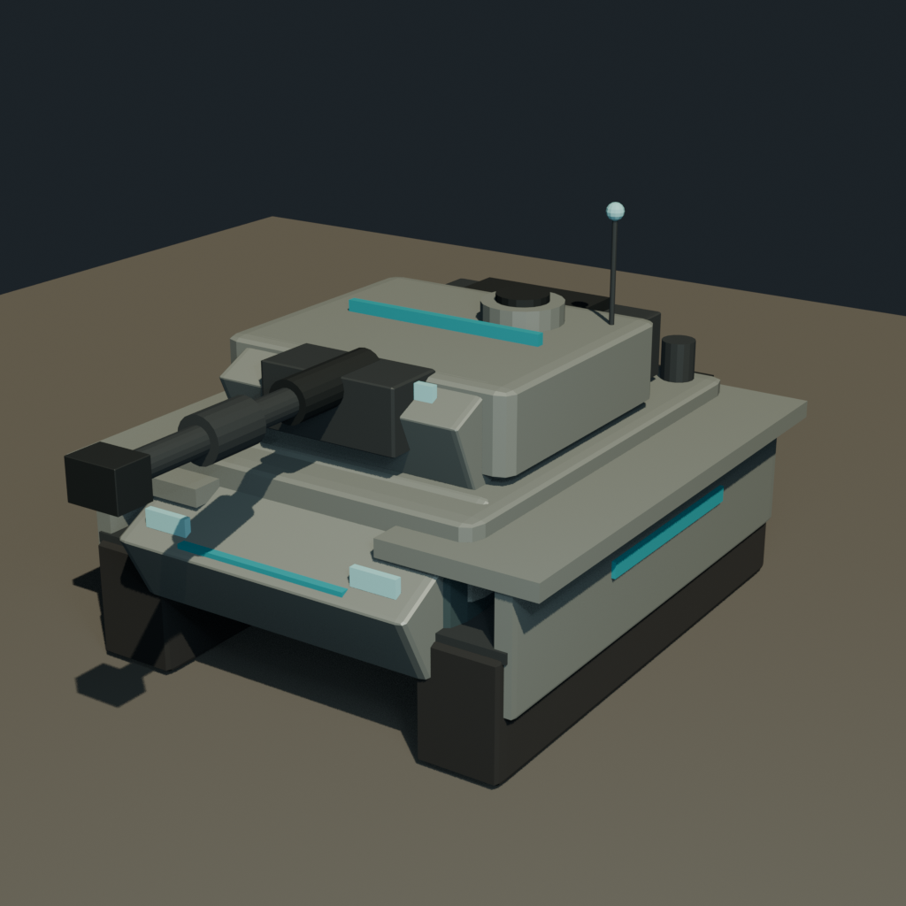
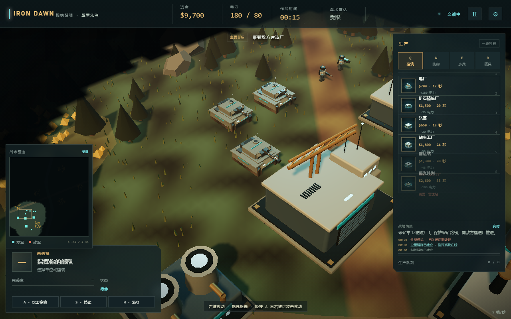
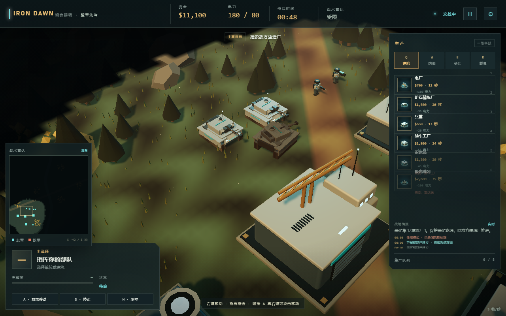
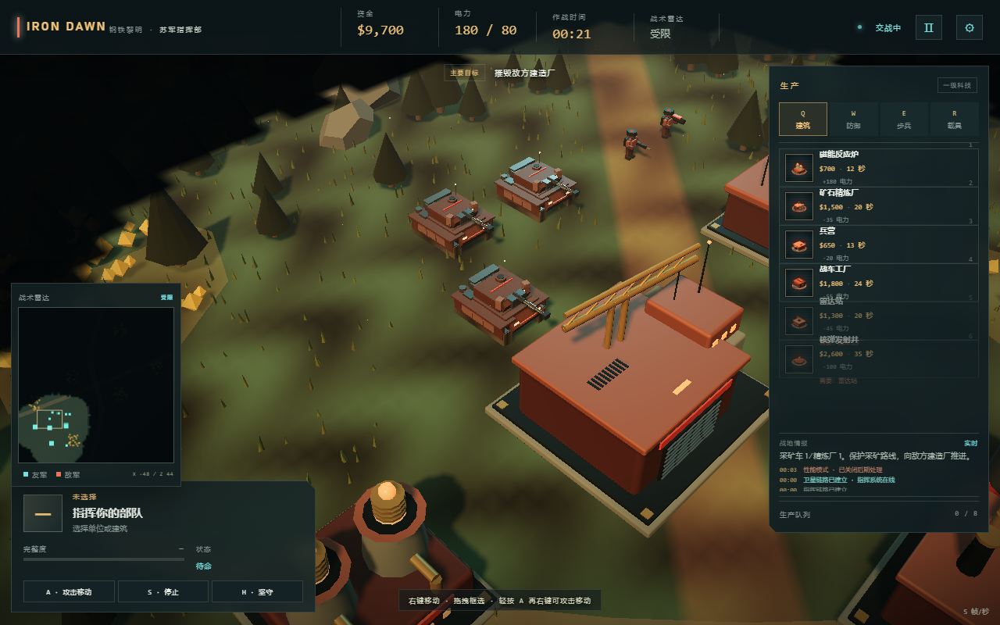

# 英雄资产：先锋主战坦克（第一版）

状态：已接入当前 3D 项目，第一轮画面与动画链路验证通过。  
资产位置：`assets/models/vanguard_tank.glb`  
Blender 源文件：`assets/models/vanguard_tank.blend`

## 1. 目标

用 Blender 精细建模替换当前 `makeModel('tank')` 的程序化坦克，验证：

- 车体、炮塔、炮管是否能按现有游戏动画约定正确拆分；
- GLB 坦克能否在炮塔旋转、炮管后坐、移动与开火时保持稳定；
- 玩家和 AI 双方坦克能否共用一套模型并通过材质区分阵营；
- 多单位场景下能否通过合批控制 draw call；
- 模型比例、朝向和炮塔枢轴是否与现有 RTS 玩法一致。

## 2. Blender 作业

- 项目 ID：`iron_dawn_vanguard_tank`
- 作业 ID：`job_bca38be6c62b4f829c234348edadff83`
- 结果：`succeeded`
- 原始场景：47 个网格对象，647 个多边形，1010 个顶点
- 导出 GLB：139,376 bytes
- GLB SHA-256：`73c4b201757fac40c252df0e3cba18ff31826deeb97fbc062a44f7bca139144b`

Blender 预览：



游戏内截图：



战损状态：



## 3. 模型规格

- 车体宽约 3.0，长约 4.2，含炮塔/天线高度约 2.8
- 前向：GLB **+Z**
- 车体原点：地面 `y = 0`
- 炮塔枢轴：约 `[0, 1.58, 0.03]`
- 炮管枢轴：炮塔局部约 `[0, 0.43, 0.85]`
- 主要结构：
  - 车体、首上装甲、尾板、侧裙、挡泥板
  - 左右各 5 个负重轮、履带基础体
  - 炮塔、炮塔前装甲、尾舱、车长塔、舱盖、烟雾发射器
  - 主炮管、抽烟装置、热护套、炮口制退器
  - 天线、车灯、阵营识别条
- 主要材质：
  - `Bridge_tank_body`
  - `Bridge_tank_armor`
  - `Bridge_tank_steel`
  - `Bridge_tank_dark`
  - `Bridge_tank_rubber`
  - `Bridge_tank_team`
  - `Bridge_tank_glow`

## 4. 运行时层级

Blender 导出的对象是平铺的。加载时在 [Models.js](../src/render/Models.js) 中重建层级：

```text
tank root
└─ body
   ├─ 合并后的车体/履带底座网格
   ├─ 左右履带链 InstancedMesh（各 18 节）
   ├─ 左右负重轮 InstancedMesh（各 5 组）
   ├─ 阵营条与车灯
   └─ turret
      ├─ 合并后的炮塔网格
      ├─ 炮塔阵营条与光学灯
      └─ barrel
         └─ 合并后的炮管网格
```

关键动画接口：

- `body`：移动时的车体起伏和轻微倾斜
- `turret`：`rotation.y = e.turret - e.angle`
- `barrel`：`position.z = 0.85 - e.recoil * 0.4`
- 坦克根节点：`rotation.y = e.angle`
- `trackMotion`：履带链相位和负重轮旋转

## 5. 阵营与合批

- 苏军运行时把 `tank_body` 调成红褐色，`tank_armor` 调成棕红色；
- 盟军保持蓝灰/灰绿色；
- `team_stripe` 和 `glow` 材质按阵营克隆并独立设置；
- 车体、炮塔、炮管分别按材质合批；
- 阵营条与发光件保持独立，不参与合批；
- 接入后一个坦克节点数量明显少于原始 47 个网格。

## 6. 动态细节

### 履带与轮组

- 运行时生成左右两侧履带链，每侧 **18 节**，使用 InstancedMesh 单 draw call；
- 履带节沿矩形路径循环移动，覆盖上、下和前后端；
- 左右各 **5 组负重轮**，带轮毂和十字辐条，使用 InstancedMesh 旋转；
- 侧裙已移除，避免遮挡履带和轮组；
- 移动时同时推进履带纹理 `offset.x` 和几何履带相位；
- LOD 远距离切换时，整套履带/轮组 InstancedMesh 随完整车体隐藏。

### 表面细节

- 车体和炮塔装甲增加运行时生成的细微划痕/面板纹理；
- 材质仍保持基础 PBR 色值，但表面不再是完全纯色；
- 纹理和履带图都由本地 Canvas 程序化生成，不依赖外部贴图。

### 战损残骸

- 重载车辆死亡时生成独立残骸；
- 复用英雄坦克模型，但克隆并压暗所有材质；
- 炮塔随机偏转、炮管下沉，形成战损姿态；
- 残骸持续冒烟并偶尔出现火光；
- 45 秒后自动移除，退出/重开游戏时统一清理。

### 盟军/苏军造型差异

苏军额外挂载一套 Blender 资产：

- 源文件：`assets/models/soviet_tank_kit.blend`
- 运行时资产：`assets/models/soviet_tank_kit.glb`
- 内容：炮塔侧颊附加装甲、炮塔尾舱、车体侧裙 ERA 块、后置外挂油箱
- 运行时按名称挂接到 `body` / `turret`，并跟随炮塔旋转
- 盟军保持基础车型，苏军获得明显的重装轮廓



### LOD

- 近距离：使用完整的车体、炮塔、炮管分组，保留全部动画；
- 远距离：切换到低面数代理网格（约 172 个顶点，单 draw call）；
- 当前阈值约 92 世界单位；
- 实测近距离相机距离约 42.7 时完整模型可见，远距离约 121.7 时切换代理；
- 代理是手工低面数车体/炮塔/炮管/履带块，不是完整模型的自动减面；
- 苏军附加套件目前不包含在远距离代理内。

## 7. 验证记录

- Blender 作业成功，GLB、blend、preview 均生成；
- 浏览器成功加载 GLB；
- 场景内确认存在 `body`、`turret`、`barrel` 层级；
- 炮塔局部位置为 `[0, 1.58, 0.03]`；
- 炮管局部位置为 `[0, 0.43, 0.85]`；
- 车体组、炮塔组、炮管组分别完成合批；
- 移动测试中履带纹理 offset 已发生变化；
- 移动测试中履带链 phase 和轮组 spin 持续更新；
- 左右各 18 节履带、5 组负重轮均成功创建；
- 击毁后成功生成压暗残骸，冒烟并出现过火光；
- 近距离/远距离 LOD 切换验证通过；
- 远距离代理顶点数约 172，完整模型 1010 顶点；
- 苏军套件成功挂接：body 子节点 13、turret 子节点 9；
- QA 控制台无捕获错误；
- 核心回归测试 8/8 通过。

## 8. 当前限制

这是第一版英雄坦克，不是最终成品：

- 车体表面纹理为程序化划痕/面板纹理，不是完整手工 PBR 材质；
- 履带为几何链 + 纹理混合，但路径是简化矩形循环，不是真实悬挂；
- 炮管只有后坐位移，没有独立俯仰；
- LOD 是手工低面数代理，不是自动减面；苏军套件不进入远距离代理；
- 没有手工烘焙 AO/Normal、残骸碰撞体；
- 当前 Blender MCP 不支持自动 UV、雕刻、绑定和复杂动画；
- 盟军/苏军已有附加装甲差异，但主车体/炮塔仍是同一基础造型。

## 9. 下一轮建议

1. 把苏军套件加入远距离代理，或做真正的自动减面；
2. 用真实悬挂和履带路径替换简化矩形循环；
3. 用真实 PBR 贴图替换程序化划痕；
4. 增加炮管俯仰和炮塔顶部舱盖细节；
5. 增加残骸碰撞和更长久的战场痕迹；
6. 做盟军/苏军不同炮塔或车体主造型；
7. 通过后再替换 `advanced` 光棱坦克/天启坦克。
