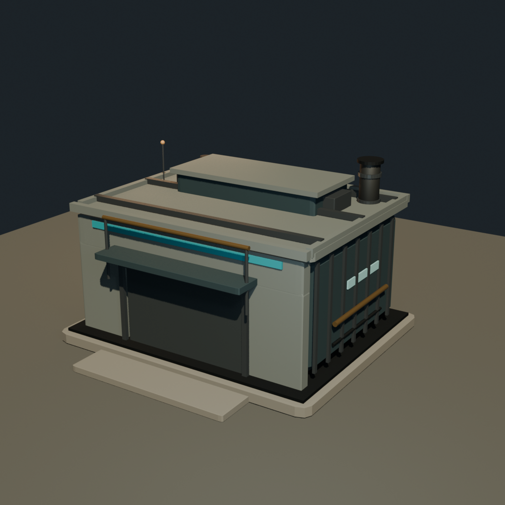
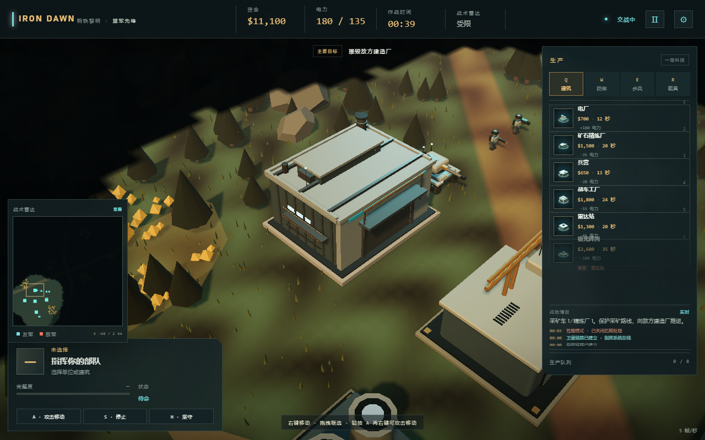

# 英雄资产：战车工厂（第一版）

状态：已接入当前 3D 项目，第一轮画面验证通过。  
资产位置：`assets/models/war_factory.glb`  
Blender 源文件：`assets/models/war_factory.blend`

## 1. 目标

用 Blender 精细建模替换当前 `makeModel('factory')` 的程序化工厂，验证：

- Blender 资产能否匹配当前 3D 游戏的比例、镜头和光照；
- GLB 能否在 Three.js 中异步加载，并保留程序化模型回退；
- 门体、烟囱、阵营灯带和建筑生长动画能否继续工作；
- 高面数/多对象模型能否在不破坏玩法的前提下进入现有游戏。

## 2. Blender 作业

- 项目 ID：`iron_dawn_war_factory`
- 作业 ID：`job_f7604046f90043ab9b9c04666885d12d`
- 结果：`succeeded`
- 原始场景：54 个网格对象，697 个多边形，1034 个顶点
- 导出 GLB：146,708 bytes
- GLB SHA-256：`a5cfe09041d670d87ef22b4364e03aad3b0e6ce5aafab86b3436e9de2792e491`

Blender 预览：



游戏内截图：



## 3. 模型规格

- 地基：约 11.4 × 9.4 游戏单位
- 主厂房：约 10 × 7.4 × 4.8
- 最高点：约 7.3（含天线）
- 正面：GLB +Z；门、门框、雨棚、阵营条和警示条均在 +Z 面
- 烟囱锚点：模型中心约 `(x + 4, y + 7.05, z - 3)`
- 主要节点：
  - `door`：门体旋转/缩放枢轴组
  - `team_stripe`：阵营色灯带
  - `glow_*`：青色发光条、侧面窗、天线灯
  - `chimney`：烟囱主体
- 主要材质：
  - `Bridge_body_teal`
  - `Bridge_armor_green`
  - `Bridge_concrete`
  - `Bridge_steel`
  - `Bridge_brass`
  - `Bridge_team_cyan`
  - `Bridge_light_cyan`

## 4. 接入方式

### 4.1 加载与回退

[main.js](../src/main.js) 在启动时异步加载：

```js
new GLTFLoader().loadAsync('./assets/models/war_factory.glb')
```

加载成功后通过 [Models.js](../src/render/Models.js) 的 `registerFactoryModel()` 注册。  
如果 GLB 尚未加载或加载失败，继续使用原有的程序化工厂，保证游戏可玩。

### 4.2 方向与锚点

模型按当前建筑坐标导出：

- 正面门朝 GLB **+Z**；
- 地基底部位于 GLB `y = 0`；
- 根节点位于建筑占地中心；
- 建造升起动画会从地面向上缩放。

### 4.3 门体动画

原始门体是网格对象。加载时会：

1. 计算门体的包围盒；
2. 创建名为 `door` 的底部枢轴；
3. 将原门体重命名为 `door_mesh` 并挂到枢轴下。

因此现有 `animateModel()` 的 `p.door.scale.y` 动画可以继续作用在门体上，且缩放起点是门底。

### 4.4 阵营色与发光

每个实例克隆后：

- `team_stripe` 使用盟军青色 / 苏军橙红色材质；
- `glow_*` 材质克隆并设置 emissive；
- 不会影响其他工厂实例的共享材质。

### 4.5 合批

原始模型有 54 个网格。加载时按材质把静态部件合并，保险起见保留：

- `door` / `door_mesh`
- `team_stripe`
- `glow_*`

接入后单个工厂场景节点从 54 个降至约 14 个，减少 draw call，同时保留门、阵营色和灯光。

### 4.6 移除预览辅助物

GLB 中的 `preview_ground` 和过大的 `front_apron` 在运行时移除，避免把 Blender 预览地面或漂浮基座带进游戏。

### 4.7 烟囱烟雾

原程序化工厂的烟雾坐标已更新为 `y + 7.05`，与 Blender 烟囱顶部对齐。

## 5. 验证记录

- Blender 作业成功，GLB、blend、preview 均生成；
- 四段配乐未受影响；
- 浏览器成功加载 GLB；
- 场景内确认存在 `factory_body`、`team_stripe`、`door`；
- 门枢轴为 Group，子节点为 `door_mesh`；
- 合批后工厂根节点约 14 个；
- QA 控制台无捕获错误；
- 核心回归测试 8/8 通过。

## 6. 当前限制

这是第一版英雄资产，不是最终成品：

- 材质仍是基础 PBR 纯色，没有完整的金属/混凝土贴图；
- 背面细节少于正面；
- 只有 697 个源多边形，细节主要来自对象拆分，不是高密度雕刻；
- 没有 LOD、碰撞体拆分、烘焙 AO/Normal；
- 当前 Blender MCP 不支持自动 UV 展开、雕刻、绑定和复杂动画；
- 图标生成依赖启动时的加载时序，极端情况下可能仍使用程序化图标。

## 7. 下一轮建议

1. 给主厂房、地基和屋顶增加可平铺的金属/混凝土贴图；
2. 补背面和屋顶后侧细节，确保 360° 镜头可看；
3. 做 LOD0/LOD1 和面数预算；
4. 补门体开合的真实卷帘动画；
5. 把烟囱、灯光、阵营色改为模型锚点/材质元数据驱动；
6. 通过后再替换第二座建筑，而不是同时替换全部。
