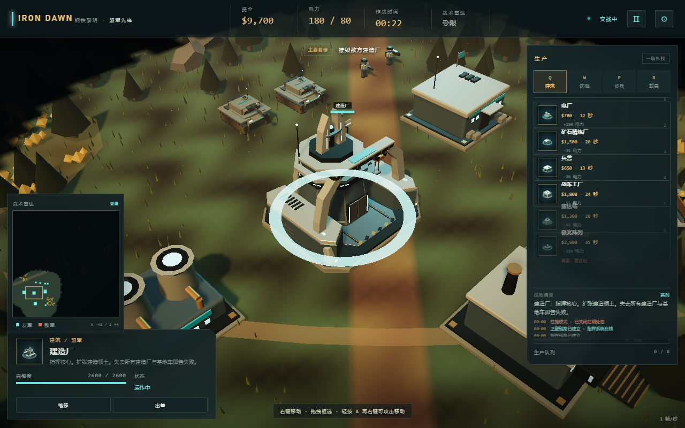
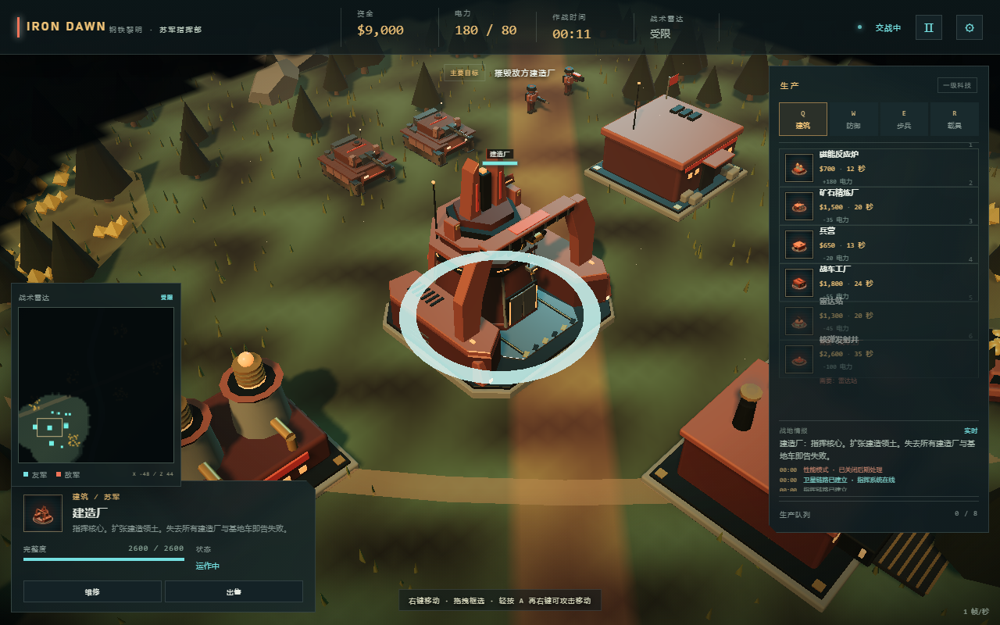

# 主基地重设计记录

## 目标

主基地是游戏核心建筑，必须拥有比电厂、兵营、精炼厂更高的视觉地位和识别度。本轮重做目标是：

- 脱离统一方盒建筑语言；
- 形成远距离可识别的中央高塔天际线；
- 体现“指挥中枢 + 建造基地”而不是普通厂房；
- 保留现有 10×9 占地和游戏逻辑。

## 新结构

- 八角形混凝土/装甲基座；
- 中央多层指挥塔、环形观测窗和顶部通讯冠；
- 双侧低矮承重翼与外扩扶壁；
- 前置开放式建造庭院和三段入口坡道；
- 大跨度建造龙门、吊装滑车和独立吊钩；
- 后置散热器、通讯桅杆和电缆；
- 中央实体阵营徽记；
- 盟军与苏军使用不同的顶部轮廓和结构语言。

## 动态部件

- 主体建筑保持静止，不再让整栋建筑做无意义旋转；
- `yard_trolley` 沿建造龙门横向平移；
- `yard_hoist` 独立上下起吊；
- `command_seal` 为静态阵营识别部件；
- 原有建造升起、损伤冒烟、坍塌和选中反馈保留。

## 兼容性

- 继续使用 `industry(root, 'yard', faction, materials)` 入口；
- 原有生产、建造范围、胜负条件、AI 和放置逻辑不变；
- 建造尺寸仍为 `10 × 9`；
- 健康条高度提高到 `9.2`，避免悬浮在中央塔内部；
- `modelMetrics('yard')` 高度改为 `9.2`。

## 验收

- [x] 主体轮廓不再是方盒；
- [x] 中央高塔在远景可识别；
- [x] 房体保持静止；
- [x] 吊装滑车和吊钩独立动画；
- [x] 盟军/苏军具有不同顶部结构；
- [x] 浏览器截图验收通过；
- [x] 核心回归测试通过。

## 当前限制

这是第一版程序化重设计，尚未使用 Blender GLB。盟军与苏军有不同的顶部冠饰与结构语言，但主塔/肩翼底层体块仍共享布局。下一步可以为主基地制作 Blender 英雄资产，但应先保留本版作为低模/回退模型，并沿用 `yard_trolley` 与 `yard_hoist` 节点命名约定。
